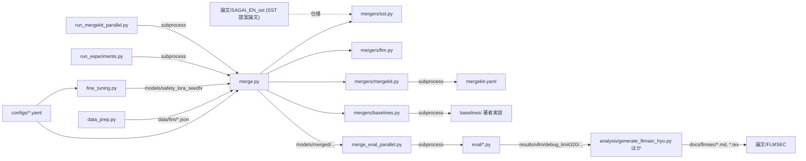
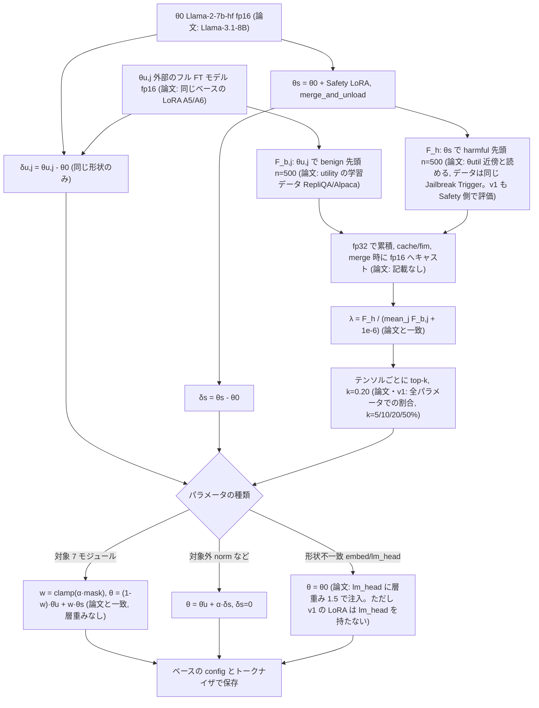
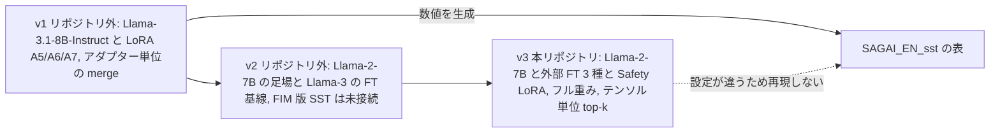
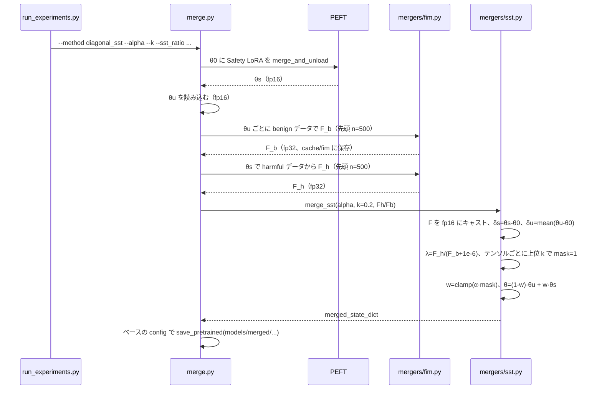
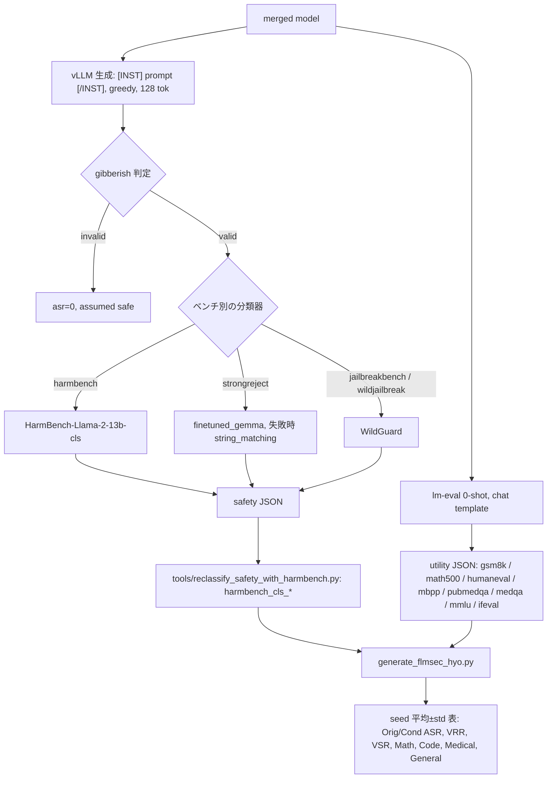

# アーキテクチャ: v3

## Architecture Analysis

### System Overview

v3 は、ファイルを介してつながるバッチ型の研究パイプラインである。常駐サービスやデータベースはない。各段階は独立した Python CLI で、YAML 設定（`configs/`）を読み、モデルを `models/` に、結果 JSON を `results/` に書き出す。段階間の受け渡しはディレクトリと命名規則だけで行う。GPU ジョブは SLURM（`scripts/slurm_*.sh`、`#SBATCH --partition=h100`）から投入する。

v3 の前身として、ワークスペース直下に `v1/`（SST-Merge の提案論文の数値を出した実験）と `v2/`（Llama-2 の実験の足場と Llama-3 系の FT ベースライン）がある。どちらも v3 のリポジトリの外にあり、v3 のコードから参照されない。系譜は本ファイルの「v1 → v2 → v3 の系譜」にまとめた。

### Architectural Style

バッチ型のスクリプト・パイプライン（モノリシックなリポジトリ内の CLI 群）。根拠は次のとおり。

- 段階ごとに CLI がある（`fine_tuning.py` → `merge.py` → `eval/*.py` → `analysis/*.py`）
- オーケストレータは他の CLI を `subprocess.run` で起動する。merge を起動するのは `run_experiments.py`（全手法）と `run_mergekit_parallel.py`（mergekit 系のみ）。`merge_eval_parallel.py` は名前に反して merge を行わず、`merge_metadata.json` の `status` が `success` のモデルを集めて評価だけを起動する（`merge_eval_parallel.py` L288-335, L977）
- 外部の merge 実装（mergekit、SafeMERGE、LED-Merging、MergeAlign）もサブプロセスで呼ぶ（`scripts/mergers/mergekit.py`, `scripts/mergers/baselines.py`）

### Component Relationships

テキスト版:
- `configs/*.yaml` を `fine_tuning.py` と `merge.py` が読む。`data_prep.py` が FIM 用データ `data/fim/*.json` を作り、`merge.py` が読む
- `fine_tuning.py` は Safety LoRA を `models/safety_lora_seed{N}` に出力し、`merge.py` がそれを読む
- `merge.py` は手法に応じて `mergers/sst.py`（SST / Fisher 系）、`mergers/fim.py`（FIM 推定）、`mergers/mergekit.py`（mergekit をサブプロセス起動）、`mergers/baselines.py`（`baselines/` の著者実装をサブプロセス起動）を使う
- `merge.py` を一括で起動するのは `run_experiments.py`（SST を含む全手法。SST の引数は明示して渡す）と `run_mergekit_parallel.py`（mergekit 系 4 手法の α スイープ）
- merge 済みモデルは `models/merged/` に出力される。`merge_eval_parallel.py` が成功したモデルだけを集め、`eval/*.py` をサブプロセスで起動する
- 評価結果は `results/vllm/debug_limit320/...` に JSON で書かれ、`analysis/` の集計スクリプトが読む
- 集計結果は `docs/flmsec/` の Markdown / LaTeX になり、論文 `論文/FLMSEC` に転記される
- `mergers/sst.py` の仕様の出典は SST-Merge の提案論文 `論文/SAGAI_EN_sst/main.tex` である（点線。コードからは参照されない）。論文の数値を出した実装はリポジトリ外の v1 にある

### Data Flow

1. `data_prep.py` が FIM 用データ（`data/fim/*.json`、各ドメイン先頭 1,000 件と有害 1,400 件）と評価用データ（`data/eval/*.json`）を作る
2. `fine_tuning.py` が Safety LoRA を seed ごとに学習する
3. `merge.py` が（パターン, 手法, α, seed）ごとに merge 済みモデルを作る。FIM が必要な手法では `cache/fim/` にキャッシュする
4. `eval_safety.py` は vLLM で greedy 生成（最大 128 トークン）し、分類器で判定する。`eval_utility.py` は lm-eval を 0-shot で実行する。どちらも `results/vllm/debug_limit320/merged/seed{N}/{pattern}/{method}/` に JSON を書く
5. `analysis/generate_flmsec_hyo.py` がディレクトリ全体を再帰的に glob し、ファイル名から（手法, パターン, α, seed, 指標）を解析して、seed 平均±標準偏差の表を作る

### Key Design Decisions

- **比較手法は公式実装を呼ぶ**（README §2、`steering_hook.py` で規約を検査）。トレードオフ: 再現性は高いが、手法ごとに入力形式を合わせる変換が必要になる（例: SafeMERGE のため full モデルを rank-16 の疑似 LoRA に SVD 変換する。`mergers/utils.py` の `convert_full_to_lora`）。代替案は全手法の自前実装で、実装差は消えるが「公式との差」を問われる。v1 は TA / TIES / DARE を自前実装していた（`v1/scripts/merging/baseline_merge.py`）
- **α を全手法に共通のノブにする**。トレードオフ: 手法間で横並びに比べやすいが、α の意味は手法ごとに違う。mergekit の `linear` では全座標での重み、SST では「上位 k 座標だけでの補間係数」、TIES / DARE では正規化付きの重みになる。SAGAI_EN_sst 自身は手法間を同じ α ではなく安全性と有用性のトレードオフ曲線で比べている（`main.tex` L806, L1772-1773）。代替案は手法ごとの最適 α の探索か、Pareto 曲線での比較（コスト増）
- **SST は自前で座標ごとに merge する**（`mergers/sst.py`）。FIM の推定は fp32 で累積するが、勾配の計算と merge の演算は fp16 である。トレードオフ: メモリ効率はよいが、FIM の小さい値が 0 に落ちる恐れがある（下の「SST-Merge の詳細」と `code-quality-assessment.md` 参照）。SAGAI_EN_sst は数値精度を書いていない
- **SST はフルの重みで merge する**。SAGAI_EN_sst はすべての手法を LoRA アダプタの単位で merge する（`main.tex` L1093）。v3 はドメインモデルが外部のフル FT モデルなので、フルの重みの差分で merge する（`scripts/merge.py` L510-542）。論文の数値を出した v1 は、LoRA の A / B 行列を要素ごとに別々に混ぜ、保存後に `merge_and_unload` でフルにしていた（`v1/core/sst_merge.py` L521-626）。代替案は v3 でも Safety と Utility を LoRA で学習し直してアダプタ単位で混ぜることだが、外部の FT モデルを使う設計と両立しない
- **validity-aware 指標**（ルールベースの gibberish 判定 ＋ HarmBench 分類器）。トレードオフ: 生成崩壊による見かけの安全を分離できるが、ルールの閾値（ユニーク語 20%、数字 60%）に依存する

セキュリティとコンプライアンスの観点: 秘密情報はルートの `.env` から読む（v3 内に鍵はない）。有害プロンプトのデータと有害な生成結果を `results/` に保存しているため、`results/` の共有範囲には注意が要る。

### Improvement Opportunities

- 集計スクリプトの絶対パスを引数化する（`/Users/saki/...` のハードコード）。本インテントの表再生成は `v5/` に新規実装する予定
- 有害判定を 1 つの定義にそろえる（HarmBench 分類器のみか、OR 判定か）
- FIM の推定（勾配）と merge の演算を fp32 で行う
- SST のマスク比率（実際に 1 になった座標の割合）を `merge_metadata.json` に記録する
- 結果ファイルの命名を 1 方式に統一する（`utility_math.json` と `utility_math_gsm8k.json` が混在）
- SAGAI_EN_sst の設定（モジュール種別の層重み、全パラメータでの top-k、Additive の soft mask、小さい α の格子）をコードで選べるようにする（下の対応表の「不一致」の行。これらは v1 にはある）

## SST-Merge の詳細

本節は、SST-Merge（`diagonal_sst`）の仕様と実装をまとめたものである。行番号は `v3/` からの相対パスで示す（v1 / v2 の行番号はワークスペース直下の `v1/`、`v2/` からの相対パスで、リポジトリ外）。

### 出典の整理

| 文書 | 位置付け | SST の記載 |
|---|---|---|
| `論文/SAGAI_EN_sst/main.tex` | **SST-Merge の提案論文**（研究者本人の説明）。タイトル「SST-Merge: Fisher-Ratio Subspace Optimization to Secure Model Merge」（L351）。IEEEtran 形式、著者は匿名化（L357-387） | FIM、λ、マスク、補間、Data-Free、ハイパーパラメータ、結果をすべて記載。**本節の第一の仕様** |
| `v1/`（リポジトリ外） | **論文の数値を出した実装と結果**。Llama-3.1-8B-Instruct と A5 / A6 / A7 の LoRA | 実装は `v1/core/sst_merge.py`（Additive）、`sst_merge_interpolation.py`、`sst_merge_data_free.py`。代表セルの照合は `code-quality-assessment.md` の「論文・v1・v2・v3 の照合」 |
| `論文/SAGAI_EN_sst/tables.tex` | `main.tex` からは読み込まれない（`\include{tables}` が L69 でコメントアウト）。内容は `論文/DLSP_hiromi2/tables.tex` とバイト単位で同一（Mistral-7B の表。`diff` で確認） | なし |
| `README.md` §3-4 | リポジトリの説明 | λ、additive、interpolation、hard mask、Data-Free の式（L120-157）。第二の参照 |
| `論文/DLSP_hiromi2/` | secure merge の提案論文。SAGAI_EN_sst が secure merge の出典として引く `\cite{11050841}`（`main.tex` L410, L450）は、`論文/SAGAI_EN_sst/main.bib` L51-59 で「Enhancing Jailbreak Resistance in Large Language Models Using Model Merge」（2025 IEEE Security and Privacy Workshops (SPW)、pp. 111-117）であり、DLSP_hiromi2 の `\title`（`論文/DLSP_hiromi2/main.tex` L351）と一致する（書誌で確認） | SST の記載なし（下の「補足: DLSP_hiromi2 との対応」） |

前回の記述「FIM、λ、マスクといった SST 固有の手順を書いた論文はない」は誤りだった。SST 固有の手順は SAGAI_EN_sst に書かれている。

### SAGAI_EN_sst による SST-Merge の定義

**問題設定**（L476-594）
- θ_util をユーティリティ（ベース）モデル、θ_safe をセキュリティパッチモデルとし、θ_merged = θ_util + Δθ とする（L490-494）
- θ_util の近傍で損失を局所二次近似し、曲率の代わりに FIM F_t(θ) = E_{x~D_t}[∇ℓ∇ℓᵀ]（t ∈ {b, h}）を使う（L522-529）。D_b は benign（ユーティリティ）、D_h は harmful（攻撃）の分布（L515）
- F_b に Tikhonov 正則化 F_b + εI をかける（L531）
- Tax(Δθ) = ½ΔθᵀF_bΔθ、Gain(Δθ) = ΔθᵀF_hΔθ（L536-546）
- max Gain s.t. ΔθᵀF_bΔθ ≤ c（L551-558）は一般化固有値問題 F_h v = λ F_b v に帰着し、固有値は「ユーティリティのコスト当たりの安全性の向上」と解釈される（L562-573）
- 上位 k 個の固有ベクトルが張る Safety subspace に Δ_s を F_b 直交射影する（L575-594）。これが Full SST で、実験には使われていない

**対角近似（Diagonal SST）**（L596-691）
- F_t ≈ diag(f_t,1, ..., f_t,d)（L601-606）。探索方向を座標軸に制限する、と説明する（L607-609）
- λ_i = f_h,i / (f_b,i + ε)（L619-623）
- hard mask: λ_i が上位 k に入る座標を 1（L631-634）。soft mask: m_i = σ(log(λ_i + δ)/τ)（L636-642）
- 注入量 Δθ = α(m ⊙ Δ_s)、α > 0 は注入の強さ（L624-629）。層の prior を入れると Δθ = α(w_layer ⊙ m ⊙ Δ_s)（L644-649）
- additive: θ_merged = θ_util + α(w_layer ⊙ m ⊙ Δ_s)（L651-659）
- interpolation: w = clip(α(w_layer ⊙ m), 0, 1)、θ_merged = (1−w)⊙θ_util + w⊙θ_safe（L661-677）。論文自身が「Task Arithmetic を座標ごとに一般化したもの」と書く（L678）
- 上位 k の境界の差 δ_k = λ_(k) − λ_(k+1) を、hard と soft を選ぶ診断に使う（L682-690）。ただし実験では使わない（L1135）

**Data-Free SST**（L693-773）
- 本文: φ_h,i = (Δ_h,i)²、φ_b,i = (Δ_b,i)²、λ̂_i = φ_h,i / (φ_b,i + ε)（L747-761）。注入は Δθ = α(m(λ̂) ⊙ Δ_h)（L762-766）。重みの大きさ θ_i² を使う案も挙げる（L736-742）
- 付録の実験設定: 「Utility/Safety proxy: magnitude (e.g., |W|)」、hard mask、k ∈ {5%, 10%, 20%}（L1138-1146）。考察も「単一の大きさの proxy（|W|）」と書く（L1761-1762）。本文の Δ² と表記が食い違う
- 付録は k を「大きさの降順で選ぶ全パラメータの割合」と書く（L1143-1144）
- **訂正（本実行で v1 の実装を読んだ結果）**: 前回は、付録の `|W|` を「同じ値を utility と safety の両方に使う」と読み、「比 λ̂ はほぼ 1 で一定になり、選択は大きさの順位だけで決まる」と解釈した。これは誤りだった。v1 の Data-Free は、Utility LoRA の重みの二乗を F_b、Safety LoRA の重みの二乗を F_h として別々に計算し、λ = (F_h + ε)/(F_b + ε) を作る（`v1/core/sst_merge_data_free.py` L29-69, L246-251）。したがって比は一定にならず、選択は二つのアダプターの大きさの比で決まり、「効率比で選ぶ」という論文の原理（L767）に沿っている。付録の `|W|` は「各アダプターの重みの大きさ」の略記で、論文の表記が曖昧なだけである。ただし v1 の proxy は LoRA の A / B 行列の各要素の二乗であって、本文の Δ²（ΔW ではない）とは別物である。v2 / v3 はフル重みのタスクベクトルの二乗（本文の式）を実装している

**実験設定**（L781-809、付録 L1059-1164）
- ベースモデル: 本文は `meta-llama-3.1-8b`（L784, L787）、付録は `meta-llama/Meta-Llama-3.1-8B-Instruct`（L1064）。論文内の表記は違うが、v1 の実装は `meta-llama/Llama-3.1-8B-Instruct`（`v1/core/sst_merge.py` L42）で付録が正しい
- LoRA: r=16、alpha=32、dropout 0.05、target modules `all-linear`（L1065）
- アダプタ（L1074-1087）: A5（Utility）= ServiceNow/repliqa、10 epoch、lr 2e-4。A6（Utility）= tatsu-lab/alpaca、10 epoch、lr 2e-4。A7（Safety）= Custom Jailbreak（TrustLLM の Jailbreak Trigger）、5 epoch、lr 2e-4
- FIM のデータ: ユーティリティは RepliQA、安全は Jailbreak Trigger。「該当する場合は FIM の推定にも使う」（L792-797）。つまり F_h の推定データは Safety の学習データと同じである
- merge の単位: すべての手法を LoRA アダプタの単位で merge し、ベースモデルに適用してから単一のフルモデルとして評価する（L1093）。v1 の実装では、A と B の各行列を別々に要素ごとに混ぜ、`merge_and_unload` でフルにして評価する
- SST の主設定（L1122-1136）: Top-k ratio は soft と k ∈ {5%, 10%, 20%, 50%}（Additive / Interpolation とも）、FIM のサンプル数 N=500、ε=10⁻⁶、層重みは表 `tab:layer_weights`。Additive は soft mask が既定で「log-scale normalization」を行い、実効の比率は名目の k に関係なく動的に決まる。Interpolation は hard mask で、k は「全パラメータのうちパッチを適用する割合」。δ_k による自動切り替えは使わない
- 層重み（表 `tab:layer_weights`、L1149-1164）: モジュール種別で、`lm_head` 1.5、`q/k/v/o_proj` 1.2、`gate/up/down_proj` 0.8
- α: 本文は「[0, 1] を 0.1 刻み」（L806）。結果の表の α は 0.05, 0.07, 0.09, 0.10, 0.12, 0.15, 0.20, 0.30, …, 1.00 の 15 点（例: L1199-1213）
- k: 本文は Additive が {Soft, 5%, 10%, 20%}、Interpolation が {5%, 10%, 20%}（L807-808）。付録と表は 50% も含む（L1126、表 `tab:res_a5_sst_50`）
- 比較手法: Task Arithmetic、TIES、DARE の 3 つだけ（L799）。TA は τ = (1−α)τ_u + ατ_s（L1097-1103, L982）。TIES は density 0.5（L1105-1107）。DARE は drop rate p=0.9（q=0.1）で、Safety の τ_s だけを疎にして再スケールする（L1109-1120, L1035-1055）。v1 のコードは両方のアダプターを疎にする（`v1/scripts/merging/baseline_merge.py` L381-416）
- 評価: 安全性は「JB Res.」（jailbreak 耐性）、有用性は RepliQA または Alpaca のスコア（各表の列）。論文には評価データの件数、判定器、採点方法、seed が書かれていない。v1 の評価コードで補うと、JB Res. は TrustLLM の分類器（`LibrAI/longformer-harmful-ro`）による拒否率（500 プロンプト、greedy、最大 256 トークン）、有用性は ROUGE-1 の F 値の平均 ×100（RepliQA は `repliqa_0` の先頭 500 件、Alpaca は `train` の先頭 500 件）である（`code-quality-assessment.md` の照合節）

**結果と主張**（L812-848、付録 L1166-1765）

付録の表は `\label` で示す。`tables.tex` は読み込まれないので、コンパイルすると付録の表は順に表 I〜XX と番号が振られると推定される（未コンパイル）。

| モデルの組 | 表（`\label`） | 内容 |
|---|---|---|
| A5 + A7 | `tab:res_a5_base`（L1190-1216） | TA / TIES / DARE |
| A5 + A7 | `tab:res_a5_sst_soft`（L1220-1246） | SST Additive soft、layer-wise あり / なし |
| A5 + A7 | `tab:res_a5_sst_{5,10,20,50}`（L1250-1367） | SST Additive / Interpolation × layer-wise |
| A5 + A7 | `tab:res_a5_sst_data_{5,10,20}`（L1371-1458） | Data-Free SST |
| A6 + A7 | `tab:res_a6_base`（L1465-1491）ほか同じ構成（L1495-1739） | A6（Alpaca）で同じ表 |

本文の図は A5 + A7 だけである（`fig:a5_baseline`, `fig:A5_A7_SST_Additive_k20`, `fig:A5_A7_SST_Interpolation_k20`、L823-844）。

論文の主張:
- SST-Merge は α を上げたときの有用性の低下が比較手法より緩やかである。特に interpolation は有用性を保ちながら jailbreak 耐性を大きく上げる（L846-848, L1174-1176, L1745-1751）
- k が小さいと有用性が保たれ、大きいと安全性が早く上がり有用性が落ちる（L1178-1180, L1753-1758）
- Data-Free SST は Full SST と同等の傾向を示す（L1182-1183, L1761-1762）。ただし interpolation で α≈0.9 のとき JB Res. と有用性が同時に崩れる（L1764-1765）
- 結論は「SST-Merge は既存手法より良い safety–utility トレードオフを達成する」（L855）

論文の表から読み取れること（本エージェントが表の数値を比べたもの。論文には書かれていない）:
- **A5 + A7**: SST Interpolation の点は TA の曲線とほぼ重なるか、その下にある。例: TA α=0.30 は（JB 86.8%, RepliQA 40.40%）、SST Interpolation k=5% layer-wise なし α=0.70 は（86.8%, 37.00%）。TA α=0.40 は（88.2%, 35.66%）、SST k=20% α=0.80 は（88.2%, 34.96%）。SST が上回るのは JB 96% を超える領域の k=50% だけ（α=1.0 で 97.6%, 26.81%）。SST Additive は α を上げても JB が 65〜76% にとどまり、有用性だけが 72% から 40% に下がる（`tab:res_a5_sst_soft`, `tab:res_a5_sst_{5,10,20,50}`）
- **A6 + A7**: SST は TA を上回る。Additive soft α=0.40 は（JB 83.2%, Alpaca 66.07%）で、同じ JB での TA の値（α=0.3 と 0.4 の間を線形補間して約 54%）より約 12 ポイント高い。Interpolation k=5% layer-wise なし α=0.80 は（89.4%, 49.40%）で、TA α=0.50（89.4%, 46.52%）より約 3 ポイント高い
- つまり、論文の「一貫して良い」は A6 では表から支持されるが、A5 では支持されない。本文の図は A5 だけを載せている
- 同じ α での比較では、SST Interpolation は TA より安全側に弱い（例: A5、α=0.6 で TA 96.4% / 20.16%、SST k=20% layer-wise なし 83.0% / 39.31%）。これは下の (a) と同じ構造である
- **数値の出所（v1 の結果ファイルとの照合）**: 論文の TA の数値は、v1 の「GEVP 無効の補間」（TA と同じ式）の結果と同じモデルの値である（rouge1 が 16 桁まで一致）。k=5% の Interpolation の列は、2 つの結果フォルダ（`v1/eval/merged/interpolation/` と先頭が空白の ` A7-7ep/interpolation/`）の値の混在である。Additive の soft の表は、k のラベルが付いた複数の run のうち k=20 のものである（`code-quality-assessment.md` の代表セル照合）

**論文ソースの不整合**（いずれもソースで確認）
- ベースモデル名が本文（`meta-llama-3.1-8b`、L784）と付録（`Meta-Llama-3.1-8B-Instruct`、L1064）で違う（v1 の実装は付録が正しい）
- α の刻みが本文（0.1 刻み、L806）と表（0.05〜0.15 を細かく取る 15 点）で違う（v1 では Interpolation の旧セットが 0.1 刻み 10 点、現行が 15 点で、表は両方の混在）
- k の集合が本文（L807-808）と付録（L1126）で違う。L1126 は `20\%\, 50\%` でカンマが抜けている
- Data-Free の proxy が本文（Δ²、L747-761）と付録・考察（|W|、L1142, L1762）で違う（v1 の実装は LoRA 重みの二乗で付録に近い。上の訂正）
- A5 の Data-Free k=10% と k=20% の表（L1411-1425 と L1441-1455）は、全セルが同じ数値である。貼り間違いではなく、v1 の旧ラベルの Data-Free の結果自体が k=5 / 10 / 20 で同一である（`code-quality-assessment.md` の照合節の事項 5。k のラベルが名目だった旧 run の可能性）
- DARE の説明（L1109-1120）は Safety の τ_s だけを疎にするが、v1 のコードは両方のアダプターを疎にする
- A7 の epoch 数は論文が 5 epoch（L1084）、v1 には 3 / 5 / 7 / 10 epoch の結果が共存し、どのセルがどれかは未確認
- soft mask の図のファイル名とラベルに `k20` が付いている（L833-835）。"Addactive" の綴り（L834, L1222, L1497）。A6 の表の前に、表の外の地の文として「SST k=5」「Data-Free SST k=5」などが残っている（L1526, L1649, L1680, L1712）
- `tables.tex` は読み込まれず、DLSP_hiromi2 の表と同じ内容である

### 入力（コード）

| 入力 | 内容 | 根拠 |
|---|---|---|
| θ₀ | `meta-llama/Llama-2-7b-hf`、fp16 で GPU に読む | `scripts/merge.py` L510-514, `configs/config_main.yaml` L7 |
| θ_s | θ₀ に Safety LoRA（`models/safety_lora_seed{N}`）を `merge_and_unload`。fp16 | `scripts/merge.py` L518-527, `scripts/mergers/utils.py` L133-139 |
| θ_u,j | パターンに含まれるドメインモデル（1 個または 3 個）。外部のフル FT モデル。fp16 | `scripts/merge.py` L533-542, `scripts/mergers/utils.py` L116-131 |
| トークナイザ | ベースモデルのもの（全モデルの FIM 推定と保存に共通） | `scripts/merge.py` L505, L633 |
| FIM データ | F_b: `data/fim/fim_benign_{math,code,medical}.json`、F_h: `data/fim/fim_harmful.json` | `configs/config_main.yaml` L18-23 |

### FIM の推定（`scripts/mergers/fim.py`）

| 項目 | 内容 | 根拠 |
|---|---|---|
| 種類 | 経験的対角 Fisher（サンプルごとの勾配二乗の平均）。ラベルは入力そのもの（モデルからのサンプリングはしない） | L54-56, L61, L69-70 |
| F_b のモデルとデータ | 各 θ_u,j。GSM8K train / Evol-Instruct-Code-80k / medical_meadow_medical_flashcards の先頭 n 件 | `scripts/merge.py` L544-563, `scripts/data_prep.py` L21-71 |
| F_h のモデルとデータ | θ_s。`response_dataframe.csv`（Safety SFT の学習データと同じ。固定の拒否文）の先頭 n 件 | `scripts/merge.py` L568-583, `scripts/data_prep.py` L78-92 |
| サンプル数 n | 主設定 500。先頭から切り出す（シャッフルなし） | L31, `configs/config_main.yaml` L75 |
| 入力形式 | `<s>[INST] {prompt} [/INST] {response}</s>`、最大 2048 トークン、1 件ずつ | L45-52 |
| 損失の対象 | 全トークン（プロンプト部分も含む） | L54 |
| 数値精度 | モデルは fp16、`model.eval()`。逆伝播は fp16 で loss scaling も autocast もない。勾配は `.float()` してから二乗し、CPU の fp32 テンソルに累積 | L14, L21, L55-61 |
| 対象パラメータ | `q/k/v/o/gate/up/down_proj` の weight（`is_target_weight`）。`lm_head` は含まない | L18-21, `scripts/mergers/utils.py` L76-77, `scripts/mergers/constants.py` L6-14 |
| 正規化 | 主設定ではなし。`--fisher_normalization` でテンソル平均による正規化ができる（主実験では未使用） | `scripts/mergers/sst.py` L129-135 |
| キャッシュ | `cache/fim/{kind}_{domain}_{model_short}_n{n}_seed{seed}.pt`（fp32 のまま保存） | L75-92, L120-138 |
| merge 時の型 | θ₀ の dtype（fp16）にキャスト | L158-161 |

### 重要度 λ、マスク、補間（`scripts/mergers/sst.py`）

パラメータ名ごと（θ₀ の `named_parameters` の順）に次を行う（L33）。

1. θ_s に名前がなければ θ₀ をそのまま使う（L36-38）
2. δ_s = θ_s − θ₀（形状が違えば 0）（L40-42）
3. δ_u,j = θ_u,j − θ₀ を、形状が同じモデルだけで作る（L44-51）。1 つもなければ θ₀ をそのまま使う（L53-55）。語彙 32001 の embed / lm_head がこれに当たり、utility 側の値は捨てられる
4. δ̄_u = mean_j δ_u,j、θ̄_u = θ₀ + δ̄_u（L71-72）
5. 対象外のパラメータ（norm など）: θ = θ̄_u + α·δ_s（L103-105）。Safety は LoRA なので δ_s = 0 で、実質 θ̄_u
6. 層の重み w_layer: `layer_wise` のときだけ、名前の中の層番号から `get_layer_prior` で決める（L107-116、`utils.py` L84-101。`uniform` は常に 1.0）
7. 対象パラメータ:
   - F̄_b = mean_j F_b,j（fp16）、F_h（fp16）（L119-127）
   - λ = F_h / (F̄_b + 1e-6)（L137-138）。ε は直書きで、`config_main.yaml` L26 の `epsilon` は使われない
   - hard mask: テンソルごとに k_elements = max(1, ⌊numel·k⌋) を取り、k 番目に大きい λ を閾値として mask = (λ ≥ 閾値)（L177-181）。同値の座標はすべて 1 になる。マスクはテンソル単位で、全体での順位づけではない
   - soft mask: mask = σ(log(λ + 1e-8)/τ)、τ = k（L182-184）。v3 の設定では使われない
   - interpolation: w = clamp(α·w_layer·mask, 0, 1)、θ = (1−w)·θ̄_u + w·θ_s（L190-192）
   - additive（アブレーションのみ）: θ = θ̄_u + α·w_layer·mask·δ_s（L188-189）
8. 演算はすべて fp16（θ₀ の dtype）で行う（L40, L49）
9. 保存: ベースモデルを新しく読み込み、`load_state_dict(strict=False)` で上書きし、ベースの config とトークナイザで保存（`scripts/merge.py` L622-633）

展開すると、主設定（interpolation, hard mask, layer_wise なし）は次のようになる。

| 座標 | merge 後の値 |
|---|---|
| 対象モジュール、mask=1（各テンソルの上位 k） | θ₀ + (1−α)·δ̄_u + α·δ_s |
| 対象モジュール、mask=0 | θ₀ + δ̄_u（= θ̄_u） |
| 対象外（norm など） | θ₀ + δ̄_u |
| 形状が違う（embed / lm_head、語彙 32001） | θ₀ |

### α の意味

- SST（interpolation）: mask=1 の座標だけで θ_s 側に α の重みを置く。mask=0 の座標では θ_s の重みは 0。SAGAI_EN_sst の式（L665-677）と同じ
- task_arithmetic（mergekit `linear`、`scripts/mergers/constants.py` L19）: safety に α、各 utility に (1−α)/n の重みを置く（`scripts/mergers/mergekit.py` L28）。形状が同じテンソルでは θ₀ + (1−α)·δ̄_u + α·δ_s（mergekit の `linear` は重みの正規化付き平均という外部仕様による。`baselines/` は未オープン）。SAGAI_EN_sst の TA の定義 θ_base + αΔ_s + (1−α)Δ_u（L982, L1101）と同じ
- したがって、対象モジュールでは SST は「task_arithmetic を各テンソルの上位 k 座標に制限したもの」と等しい。同じ α で注入される安全成分は α·mask⊙δ_s で、task_arithmetic の α·δ_s より少ない。SAGAI_EN_sst も interpolation を「Task Arithmetic を座標ごとに一般化したもの」と書いている（L678）

### ハイパーパラメータ（コードと論文）

| 項目 | v3 主設定 | v3 アブレーション | SAGAI_EN_sst | 根拠 |
|---|---|---|---|---|
| k（マスク比率） | 0.20（テンソルごと） | `config_ablation.yaml`: 0.20 のみ。`config_ablation2.yaml`: 0.01, 0.05, 0.10, 0.20 | 5%, 10%, 20%, 50% と soft（全パラメータでの割合、L1126, L1133）。v1 は 5〜50% の 6 値と soft | `config_main.yaml` L74, `config_ablation.yaml` L77, `config_ablation2.yaml` L77 |
| FIM サンプル数 n | 500 | {50, 100, 500}（`config_ablation2.yaml` は 250 も） | N=500（L1127） | `config_main.yaml` L75, `config_ablation.yaml` L78, `config_ablation2.yaml` L78 |
| sst_ratio | `Fh/Fb` | `Fh/Fb`, `Fh only`, `1/Fb only`, `magnitude`（\|δ_s\|）, `random` | λ = f_h/(f_b+ε) のみ（L621） | `config_ablation.yaml` L80-85, `sst.py` L137-148 |
| variant | interpolation | additive, interpolation | additive と interpolation の両方が主設定（L802-803） | `config_ablation.yaml` L87-89 |
| mask | hard mask | hard mask のみ（soft はコメントアウト） | Additive は soft が既定、Interpolation は hard（L1130-1134） | `config_ablation.yaml` L91-93, `sst.py` L177-184 |
| layer_wise / prior | false / uniform | true（uniform, sin, linear, exp）と false | 層重みは各構成で「あり / なし」を評価。重みはモジュール種別（`lm_head` 1.5、attention 1.2、MLP 0.8、L1149-1164） | `config_ablation.yaml` L95-103, `utils.py` L84-101 |
| α | 0.0, 0.2, 0.4, 0.6, 0.8, 1.0 | 同じ | 0.05〜1.00 の 15 点（表）、本文は 0.1 刻み（L806） | `config_main.yaml` L71 |
| ε | 1e-6（直書き） | 同じ | 10⁻⁶（L1128） | `sst.py` L138 |
| seed | Safety LoRA の seed 42/43/44（F_h も seed ごと） | 同じ | 記載なし | `utils.py` L133, `fim.py` L87-90 |
| 拡張（`norm_standardization`, `fisher_normalization`, `norm_clipping`） | off | off（設定にない） | 記載なし | `merge.py` L67-70 |
| 掃引方式 | — | 中心条件（Fh/Fb, interpolation, hard, k=0.20, n=500, layer_wise なし）から 1 軸だけ変える | k × variant × layer-wise の全組み合わせ（表） | `merge_eval_parallel.py` L219-228 |

Data-Free SST（`data_free_sst`）は、F_h の代わりに δ_s²、F̄_b の代わりに mean_j δ_u,j² を使う（`sst.py` L150-163）。以降のマスクと補間は同じである。SAGAI_EN_sst の本文の式（L747-761）と一致する。付録の |W|（L1142）は、v1 の実装（LoRA 重みの二乗）に近く、v3 の Δ² とは proxy の定義が違う（上の訂正）。

### SST merge の流れ（論文との分岐点つき）

テキスト版:
1. θ₀（Llama-2-7b-hf、fp16）に Safety LoRA を merge して θ_s を作る。δ_s = θ_s − θ₀。論文のベースは Llama-3.1-8B
2. 各ドメインモデル θ_u,j から δ_u,j = θ_u,j − θ₀ を作る（形状が同じテンソルだけ）。ドメインモデルは外部のフル FT モデルである。論文では、同じベースに学習した LoRA（A5 / A6）を使い、アダプタ単位で merge する
3. F_b,j を θ_u,j と benign データの先頭 500 件で、F_h を θ_s と harmful データ（Safety SFT と同じデータ）の先頭 500 件で推定する。論文は F_t を θ_util の近傍で定義し（評価点は明示されない）、F_b のデータはユーティリティの学習データ、F_h のデータは Jailbreak Trigger（Safety の学習データと同じ）とする。論文の数値を出した v1 も、F_h は Safety LoRA を載せたモデルで推定している
4. 勾配の二乗を fp32 で累積してキャッシュし、merge 時に fp16 にキャストする。論文は数値精度を書いていない
5. λ = F_h / (mean_j F_b,j + 1e-6)。式と ε は論文と同じ
6. テンソルごとに λ の上位 20% を mask=1 にする（同値はすべて 1）。論文と v1 は k を「全パラメータのうちの割合」（連結した全体での順位）とし、5 / 10 / 20 / 50% を評価する
7. 対象 7 モジュールでは w = clamp(α·mask) とし、θ = (1−w)·θ̄_u + w·θ_s にする（論文の interpolation と同じ式）。主設定に層重みはない。対象外のパラメータは θ̄_u + α·δ_s（実質 θ̄_u）。形状が違う embed / lm_head は θ₀ にする。論文の層重み表は `lm_head` にも 1.5 を与えるが、v1 の LoRA は `lm_head` を対象にしない
8. ベースモデルの config とトークナイザで保存する

### 論文（SAGAI_EN_sst）とコードの対応表

「論文」は `論文/SAGAI_EN_sst/main.tex`（行番号は L で示す）。判定は「一致」「部分一致」「不一致」「論文に記載なし」のいずれかで、根拠の種類を括弧に書く（コードで確認 / 論文で確認 / 解釈を含む）。「コード」は v3 のこと。v1 との関係は各行に補足した（詳しい 4 者の照合は `code-quality-assessment.md` の照合節）。

| # | 手順 | SAGAI_EN_sst の記載 | コードの実装（file:line） | 判定 |
|---|---|---|---|---|
| 1 | 問題設定 | θ_merged = θ_util + Δθ（L490-494）。max ΔᵀF_hΔ s.t. ΔᵀF_bΔ ≤ c → 一般化固有値問題（L551-573） | 対角近似だけを実装。Full SST（F_b 直交射影、L587-594）はない | 部分一致（論文の実験も対角近似と Data-Free だけ。コードと論文で確認） |
| 2 | 二次近似の展開点 | θ_util の近傍で近似し、F_t(θ) を D_t 上で定義（L522-529） | F_b は各 θ_u,j で、F_h は θ_s で推定（`scripts/merge.py` L552-563, L572-583） | 不一致（解釈を含む。論文の式は F_b と F_h を同じ θ_util 近傍で評価すると読める。コードは F_h を Safety モデルで評価する。**v1 の原実装も F_h を「ベース + Safety LoRA」で評価しており、v3 固有のずれではなく v1 からの引き継ぎ**） |
| 3 | FIM の種類 | F_t = E[∇ℓ∇ℓᵀ]（L524-529）。対角近似 F_t ≈ diag(f_t)（L601-606） | 経験的対角 Fisher。ラベルは入力、全トークンの損失（`scripts/mergers/fim.py` L54-61, L69-70） | 一致（ラベルの取り方と損失の範囲は論文に記載なし。v1 は勾配の分散で、この点は論文と不一致） |
| 4 | F_h のデータ | Safety data = Jailbreak Trigger。FIM の推定にも使う（L792-797） | `response_dataframe.csv`（Jailbreak Trigger、Safety SFT と同じ）の先頭 n 件（`scripts/data_prep.py` L78-92, `scripts/fine_tuning.py` L87-93） | 一致（コードと論文で確認） |
| 5 | F_b のデータ | Utility data = RepliQA（A5 の学習データ）。FIM の推定にも使う（L792-797, L1082） | GSM8K / Evol-Instruct-Code-80k / medical_meadow_medical_flashcards の先頭 n 件（`scripts/data_prep.py` L21-71） | 不一致（設定差。論文はユーティリティモデル自身の学習データ。コードのデータがドメインモデルの学習データと同じかは未確認。v1 は RepliQA / Alpaca で論文と一致） |
| 6 | サンプル数 | N=500（L1127） | 500、先頭から切り出し（`configs/config_main.yaml` L75, `fim.py` L31） | 一致（切り出し方は論文に記載なし。v1 はランダムに 500 件） |
| 7 | 数値精度と正規化 | 記載なし | fp16 で逆伝播、fp32 で累積、merge 時に fp16 にキャスト（`fim.py` L55-61, L161）。正規化なし（`sst.py` L129-135） | 論文に記載なし |
| 8 | 正則化 ε | F_b + εI（L531）、ε=10⁻⁶（L1128） | `f_b + 1e-6` を直書き（`sst.py` L138）。`config_main.yaml` L26 の `epsilon` は読まれない | 一致（v1 は F 自体にも 1e-6 を足すので実効 ε は約 2e-6） |
| 9 | λ | λ_i = f_h,i / (f_b,i + ε)（L619-623） | `lambda_val = f_h / (f_b + 1e-6)`（`sst.py` L137-138） | 一致 |
| 10 | 複数のユーティリティモデル | ユーティリティは 1 つ（A5 または A6） | F̄_b = mean_j F_b,j、δ̄_u = mean_j δ_u,j（`sst.py` L71-72, L119-125） | 論文に記載なし（コードの拡張） |
| 11 | hard mask の単位 | 上位 k の座標を 1（L631-634）。k は「全パラメータのうちの割合」（L1133, L1144） | テンソルごとに上位 k、同値はすべて 1（`sst.py` L177-181） | 部分一致（解釈を含む。論文は全体での順位づけと読め、**v1 は全 LoRA 要素を連結したグローバルな順位づけで実装している**。コードはどのテンソルにも一律に k を入れる。同値の扱いは論文に記載なし） |
| 12 | soft mask | m = σ(log(λ+δ)/τ)（L638）。Additive の既定で「log-scale normalization」を行い、実効の比率は名目の k に関係なく決まる（L1132） | σ(log(λ+1e-8)/τ)、τ = k（`sst.py` L182-184）。v3 の設定では未使用（`config_ablation.yaml` L93, `config_ablation2.yaml` L93 でコメントアウト） | 部分一致（式の形は一致。「log-scale normalization」に当たる処理は v3 にない。**v1 には、log(λ) を 5〜95 パーセンタイルで [0,1] に線形正規化する処理がある**）。τ の値は論文に記載なし |
| 13 | δ_k 診断 | hard / soft の選択の目安（L682-690）。実験では使わない（L1135） | 実装なし | 一致（どちらも使わない） |
| 14 | 層の重み | w_layer ⊙ m ⊙ Δ_s（L644-649）。モジュール種別の重み: `lm_head` 1.5、`q/k/v/o_proj` 1.2、`gate/up/down_proj` 0.8（L1149-1164） | 層番号の関数（uniform / sin / linear / reverse_linear / exp）（`utils.py` L84-101, `sst.py` L107-116）。モジュール種別の重みはない。`lm_head` は対象外（`constants.py` L6-14） | 不一致（コードで確認。**v1 はモジュール種別の重みを実装している。ただし v1 の LoRA は `lm_head` を持たないので 1.5 は実効なし**） |
| 15 | additive | θ_util + α(w_layer ⊙ m ⊙ Δ_s)（L651-659） | `param_util_mean + alpha * (w_layer * mask * delta_safe)`（`sst.py` L188-189） | 一致（θ_util は θ̄_u） |
| 16 | interpolation | w = clip(α(w_layer ⊙ m), 0, 1)、θ = (1−w)θ_util + wθ_safe（L661-677） | `w = clamp(alpha * (w_layer * mask), 0, 1)`、`(1-w)*param_util_mean + w*param_safe_for_merge`（`sst.py` L190-192） | 一致（**v1 の補間は clip がなく、層重みで w>1 になりうる**） |
| 17 | α の意味 | 注入の強さ α > 0（L629）。Safety Weight α ∈ [0, 1]（L1094） | 全手法に共通の `--alpha`（`merge.py` L79）。mergekit では safety に α、utility に (1−α)/n（`mergekit.py` L28） | 一致 |
| 18 | α の格子 | 0.05〜1.00 の 15 点（例: L1199-1213）。本文は 0.1 刻み（L806） | 0.0, 0.2, …, 1.0 の 6 点（`config_main.yaml` L71） | 不一致（設定差。論文で SST の差が出る小さい α の領域を v3 は取っていない） |
| 19 | k の値 | 5 / 10 / 20 / 50% と soft（L1126、表 `tab:res_a5_sst_*`） | 主設定 0.20。`config_ablation2.yaml` は 0.01〜0.20（L77）。0.50 はない | 部分一致 |
| 20 | merge の単位 | すべての手法を LoRA アダプタの単位で merge（L1093） | フルの重みの state_dict で merge（`merge.py` L510-542, `sst.py` L33） | 不一致（アダプタ単位で SST のマスクをどこにかけるかは論文に記載なし。**v1 は A と B の各要素にかけ、交差項を含む**） |
| 21 | 対象パラメータ | LoRA の target は `all-linear`（L1065）。層重みは `lm_head` を含む（L1159） | 7 種の proj の weight（`constants.py` L6-14, `utils.py` L76-77）。embed / lm_head は形状が違えば θ₀（`sst.py` L50-55） | 部分一致（Llama では `all-linear` は 7 種の proj に当たると考えられる（外部知識）。v1 の FT も 7 種の proj。`lm_head` の扱いは v3 との差だが、v1 の LoRA にも `lm_head` はない） |
| 22 | ベースモデル | `meta-llama-3.1-8b`（L784）/ `Meta-Llama-3.1-8B-Instruct`（L1064） | `meta-llama/Llama-2-7b-hf`（`config_main.yaml` L7）。`steering_hook.py` L117 は Llama-3.1-8B-Instruct も許可するが、v3 の設定は使わない | 不一致（設定差。v1 の実装は `meta-llama/Llama-3.1-8B-Instruct` で付録が正しい） |
| 23 | ユーティリティモデル | 同じベースに学習した LoRA。A5 = RepliQA、A6 = Alpaca、各 10 epoch（L784-790, L1082-1083） | 外部のフル FT モデル: WizardMath-7B-V1.0、WizardCoder-Python-7B（CodeLlama 系）、medalpaca-7b（LLaMA-1 系）（`config_main.yaml` L8-11） | 不一致（論文が前提にする「同じ事前学習モデルからの FT」（L441-444）を code と medical は満たさない） |
| 24 | Safety モデル | A7 = LoRA r=16、alpha=32、dropout 0.05、`all-linear`、Jailbreak Trigger、5 epoch、lr 2e-4（L1065, L1084） | LoRA r=16、alpha=32、dropout 0.05、7 種の proj（`fine_tuning.py` L156-167）、既定 3 epoch（L24）、lr 2e-4（L25）、`response_dataframe.csv` | 部分一致（epoch 数が違う。v1 の A7 は epoch が 3 / 5 / 7 / 10 の結果が共存） |
| 25 | Data-Free の proxy | 本文: λ̂ = Δ_h²/(Δ_b²+ε)（L747-761）。付録: \|W\|（L1142, L1762） | δ_s² / (mean_j δ_u,j² + 1e-6)（`sst.py` L150-163） | 本文と一致、付録は表記が曖昧（論文内の不整合）。v1 は Utility と Safety の LoRA の重みの二乗を別々に求めて比を取る（付録に近い。前回の「比が一定」の解釈は誤り） |
| 26 | 比較手法 | TA、TIES（density 0.5）、DARE（p=0.9、τ_s だけを疎にする）（L799, L1097-1120） | mergekit の `linear` / `ties` / `dare_ties` / `della`。density は 0.5、重みは α と (1−α)/n、TIES と DARE は `normalize: True`（`mergekit.py` L28-49, `constants.py` L16-21）。ほかに SafeMERGE / LED / MergeAlign / MatEna / FWA | TA は一致。TIES は部分一致（論文は θ_util + αΔ^TIES、L1027）。DARE は不一致（drop 率 0.9 対 density 0.5、Safety だけ対 両方。v1 のコードも両方を疎にする） |
| 27 | 評価 | JB Res. と RepliQA / Alpaca のスコア（各表の列、L1772）。評価データ、判定器、件数の記載なし | HarmBench / JailbreakBench / StrongREJECT / WildJailbreak の ASR と validity-aware 指標、Math / Code / Medical / General（`config_main.yaml` L28-47） | 不一致（設定差。v1 は TrustLLM の longformer 分類器の拒否率と ROUGE-1） |
| 28 | seed | 記載なし | Safety LoRA の seed 42 / 43 / 44 | 論文に記載なし |

### 補足: DLSP_hiromi2 との対応（第二の参照）

`論文/DLSP_hiromi2/main.tex` と `tables.tex` は secure merge の提案論文で、SST の手順は書かれていない。前回の比較のうち、枠組みにかかわる結果だけを残す。

| 手順 | DLSP_hiromi2 の記載 | コード | 判定 |
|---|---|---|---|
| 枠組み | 安全特化のパッチモデルを FT モデルに merge して jailbreak 耐性を上げる（`main.tex` L1221-1231, L1368） | Safety LoRA モデル θ_s をドメインモデル θ_u と merge（`scripts/merge.py` L496-617） | 一致 |
| ベースと FT モデル | Mistral-7B-v0.1 / v0.3 と、その系統の FT モデル 3 種（`main.tex` L436, `tables.tex` L18-32） | Llama-2-7b-hf と系統の違う 3 モデル（`configs/config_main.yaml` L7-11） | 不一致（設定差） |
| パッチの学習 | JAILBREAK TRIGGER 1,400 件を 1,200 / 200 に分割、LoRA r=8（`main.tex` L1383, L1527, L949） | 全件で学習、LoRA r=16（`scripts/fine_tuning.py` L87-93, L156-167） | 不一致 |
| merge 演算 | mergekit の Linear と Task Arithmetic、重み 0.5 / 0.5、`dtype: float16`（`main.tex` L442-456, L1541-1552） | SST は自前実装。比較手法の `task_arithmetic` は mergekit の `linear`、α を 0〜1 で掃引、`float16`（`constants.py` L19, `mergekit.py` L36） | 部分一致 |
| 評価 | TrustLLM の RtA、StrongREJECT、AdvBench / GCG / PAIR / TAP、MT-Bench（`main.tex` L478-528） | 4 ベンチの ASR と validity-aware 指標 | 不一致（設定差） |

`main.tex` は L422 の `\iffalse` から L1344 の `\fi` までが本文を囲んでおり、ソースのとおりにコンパイルすると出力はタイトルと付録だけになる（コンパイル結果は確認していない）。

### v1 → v2 → v3 の系譜

v1 と v2 はリポジトリ外（ワークスペース直下の `v1/`、`v2/`）で、読むだけで実行していない。v3 のコードは v1 / v2 を import しない。つながりは、設計と設定の引き継ぎである。

テキスト版:
- v1 が SAGAI_EN_sst の表の数値を生成した。v2 は Llama-2-7B の merge の足場（FIM 版 SST を含む）と Llama-3 系の FT ベースラインを作った。v3 は v2 の枠組みに Safety LoRA と FIM 版 SST を実装し、評価を替えた
- 論文の数値の出所は v1 だけである（`code-quality-assessment.md` の代表セル照合）。v3 は論文の再現を目的とした設定を持たない

| 要素 | v1 | v2 | v3 |
|---|---|---|---|
| ベースと用途 | Llama-3.1-8B-Instruct。A5 = RepliQA、A6 = Alpaca、A7 = Safety の LoRA（r=16）を merge | `scripts/merge/` は Llama-2-7B の 3 ドメインモデルのパターン merge（Safety モデルなし）。`scripts/fine_tuning/` は Llama-3(.1)-8B-Instruct の FT ベースライン（`results/` に両方の名前のフォルダ） | Llama-2-7b-hf + 外部のフル FT 3 種 + Safety LoRA（seed 3 本） |
| SST の実装 | `core/sst_merge.py`（Additive）、`sst_merge_interpolation.py`、`sst_merge_data_free.py` | `scripts/merge/sst_merge_core.py` に関数があるが、`run_sst_merge.py` はダミーテンソルのデモで未接続。`merge_llama2_sst_suite.py` で動く SST は Data-Free だけで、`sst_merge` の指定は TA の分岐に落ちる | `scripts/mergers/sst.py`（`diagonal_sst`, `data_free_sst`, `fisher_weighted`） |
| FIM | LoRA 要素の勾配の分散（バッチ 4）。F_b はベース + Utility LoRA、F_h はベース + Safety LoRA | バッチ勾配の二乗の平均（関数のみ） | サンプルごとの勾配二乗の平均。F_b は各 θ_u,j、F_h は θ_s（v1 から引き継ぎ） |
| λ と ε | F_h/(F_b+1e-6)（実効 ε は約 2e-6） | 同じ式 | 同じ式（ε=1e-6 直書き） |
| top-k の単位 | 全 LoRA 要素を連結したグローバル | core はグローバル、suite はテンソルごと | テンソルごと |
| soft mask | log-percentile の線形正規化（Data-Free は z-score のシグモイド） | z-score のシグモイド | σ(log λ / τ)、未使用 |
| 層重み | モジュール種別（1.5 / 1.2 / 0.8）。Data-Free は 1.0 / 0.8 / 0.6 で既定 off | なし | 層番号の関数、主設定 off |
| merge の単位 | LoRA の A / B 要素を別々に混ぜて `merge_and_unload` | フル重み | フル重みの差分 |
| Data-Free の proxy | LoRA 重みの二乗（Utility / Safety 別々） | フル重みの Δ²（自分 / 他モデルの比） | フル重みの Δ² |
| 比較手法 | TA / TIES / DARE の自前実装（A / B 要素） | mergekit と簡易実装 | mergekit と公式実装の呼び出し |
| 評価 | TrustLLM 分類器の拒否率と ROUGE-1（各 500 件） | config に 4 ベンチと lm-eval（実装は FT ベースライン側） | 4 ベンチの ASR と validity-aware 指標、lm-eval |
| 規約フック | なし | `scripts/steering_hook.py` と `test_steering_hook.py`（Llama-2 とドメインモデルを許可） | `scripts/steering_hook.py`（同名。v2 と同一かは未確認） |

## Interaction Diagrams

### 1. SST-Merge による 1 回の merge（diagonal_sst, interpolation, hard mask）

テキスト版:
1. `run_experiments.py` が SST の引数（α、k、比率、variant、mask、layer_wise、n）を明示して `merge.py` を起動する
2. `merge.py` が θ₀ に Safety LoRA を merge して θ_s を作り、各 θ_u を fp16 で読み込む
3. `fim.py` が θ_u ごとに benign データで F_b を、θ_s で harmful データから F_h を推定する（各 500 件、fp32 で `cache/fim` にキャッシュ）
4. `sst.py` が F を fp16 にキャストし、δ_s=θ_s−θ₀ と δ_u=mean(θ_u−θ₀) を求め、λ=F_h/(F_b+1e-6) の上位 k=20% の座標をテンソルごとに mask=1 にする
5. 対象モジュール（q/k/v/o/gate/up/down_proj の weight）では w=clamp(α·mask) とし、θ=(1−w)θ_u+wθ_s とする。対象外のパラメータは θ_u+αδ_s、形状が違うテンソルは θ₀ とする
6. 結果をベースモデルの config とトークナイザで `models/merged/` に保存する

### 2. 評価と採点（安全性 1 タスク ＋ 特化 3 タスク）

テキスト版:
1. merge 済みモデルで、`<s>[INST] prompt [/INST]` 形式のプロンプトに対し、vLLM で greedy 生成する（最大 128 トークン）
2. 応答ごとに gibberish 判定をする（空、5 語以上でユニーク語 20% 未満、5 語以上で数字語 60% 超）。invalid の応答は asr=0（「assumed safe」）とする
3. valid の応答はベンチ別の分類器で判定する。harmbench は HarmBench-Llama-2-13b-cls、strongreject は finetuned_gemma（失敗時は string_matching）、jailbreakbench と wildjailbreak は WildGuard
4. 後から `tools/reclassify_safety_with_harmbench.py` が全ベンチに `harmbench_cls_*` を付与する
5. 有用性は lm-eval（0-shot、chat template を適用）で測る
6. `generate_flmsec_hyo.py` が両方の JSON を集計して表を作る
